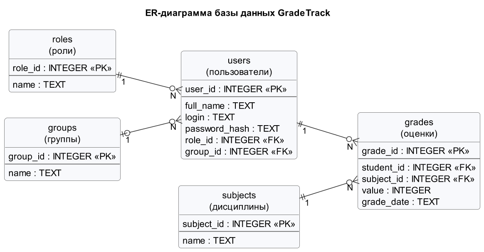

# GradeTrack
**GradeTrack** — консольная программа на *Python* для учёта оценок студентов. Учебный проект, кафедра ВСТ, НГТУ им. Р.Е. Алексеева.

Сейчас программа выводит приветствие `Hello, World!`, создаёт базу данных *SQLite* с тестовыми данными и показывает содержимое её таблиц.

## Постановка задачи

Система нужна, чтобы хранить оценки студентов по дисциплинам и следить за успеваемостью. В ней три роли:

| Роль | Что делает в системе |
| --- | --- |
| Администратор | Добавляет и удаляет студентов и преподавателей, создаёт группы и дисциплины |
| Преподаватель | Выставляет, изменяет и удаляет оценки, смотрит оценки группы и список должников |
| Студент | Смотрит свои оценки и средний балл |

Каждый пользователь сначала входит в систему по логину и паролю. Оценка — **целое число от 2 до 5**.

## Диаграммы

* [Use Case диаграмма](docs/diagrams/usecase.png) — кто и что делает в системе ([исходник на PlantUML](docs/diagrams/usecase.puml));
* [Блок-схема добавления оценки](docs/diagrams/flowchart_add_grade.png) — проверка студента, дисциплины и оценки;
* [Блок-схема просмотра оценок](docs/diagrams/flowchart_view_grades.png) — вывод оценок и среднего балла;
* [ER-диаграмма](docs/diagrams/erd.png) — структура базы данных.

## Структура проекта

```text
GradeTrack/
│
├── docs/
│   └── diagrams/                     # Диаграммы проекта
│       ├── usecase.puml              # Use Case диаграмма на PlantUML
│       ├── usecase.png               # Изображение Use Case диаграммы
│       ├── flowchart_add_grade.png   # Блок-схема добавления оценки
│       ├── flowchart_view_grades.png # Блок-схема просмотра оценок
│       └── erd.png                   # ER-диаграмма базы данных
│
├── src/                              # Исходный код
│   └── gradetrack/                   # Пакет программы
│       ├── __init__.py               # Делает папку пакетом Python
│       ├── main.py                   # Точка входа: приветствие, создание базы, вывод таблиц
│       └── database/                 # Работа с базой данных
│           ├── __init__.py           # Делает папку пакетом Python
│           ├── database.py           # Подключение к SQLite, создание базы, вывод таблиц
│           └── schema.sql            # Создание таблиц и тестовые данные
│
├── .gitignore                        # Файлы, которые Git не отслеживает
└── README.md                         # Описание проекта
```

## База данных

Данные хранятся в *SQLite*: вся база — один файл, отдельный сервер не нужен.

| Таблица | Что хранит | Связи |
| --- | --- | --- |
| `roles` | Роли: администратор, преподаватель, студент | — |
| `groups` | Учебные группы | — |
| `users` | Пользователи: ФИО, логин, хэш пароля, роль и группа (группа есть только у студентов) | `role_id` → `roles`, `group_id` → `groups` |
| `subjects` | Дисциплины | — |
| `grades` | Оценки студентов по дисциплинам с датой | `student_id` → `users`, `subject_id` → `subjects` |

Все связи «один ко многим»: у роли много пользователей, в группе много студентов, у студента и у дисциплины много оценок.



Таблицы создаются SQL-скриптом [`schema.sql`](src/gradetrack/database/schema.sql): сначала удаляются старые таблицы
(`DROP TABLE IF EXISTS`), затем создаются новые (`CREATE TABLE`) и заполняются тестовыми данными (`INSERT INTO`).

Тестовые данные: 3 роли, 2 группы, 3 дисциплины, 8 пользователей (администратор `admin`, преподаватель `teacher`
и 6 студентов) и 16 оценок. У тестовых пользователей пароль совпадает с логином. Все ФИО вымышленные.

## Запуск

Нужен *Python 3*, сторонние библиотеки не используются.

```bash
git clone https://github.com/the-sellar/GradeTrack.git
cd GradeTrack
python src/gradetrack/main.py
```

В VS Code можно открыть `src/gradetrack/main.py` и нажать *Run Python File*.

При каждом запуске программа заново создаёт таблицы в файле `gradetrack.db` в корне проекта (в Git он не хранится) и выводит их:

```text
Hello, World! GradeTrack - система учёта оценок студентов.
База данных создана: ...\GradeTrack\gradetrack.db

roles - записей: 3
role_id | name
1 | Администратор
2 | Преподаватель
3 | Студент
...
```

## Используемые технологии

* Python 3 и модуль `sqlite3`;
* SQLite;
* Git и GitHub;
* PlantUML и Markdown.

## Автор

Фролов Антон, группа 26-ИВТ-4-2 (ИРИТ), НГТУ им. Р.Е. Алексеева, 2026.
