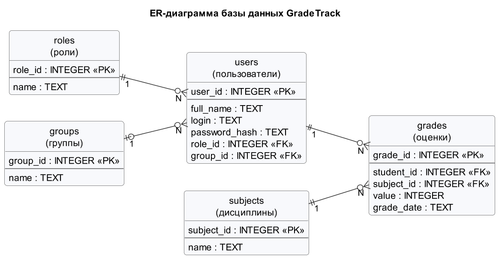

# GradeTrack
**GradeTrack** — консольная программа на *Python* для учёта оценок студентов. Учебный проект, кафедра ВСТ, НГТУ им. Р.Е. Алексеева.

Программа хранит данные в *SQLite*, позволяет входить под разными ролями и работать с пользователями, группами, дисциплинами и оценками через консольное меню.

## Постановка задачи

Система нужна, чтобы хранить оценки студентов по дисциплинам и следить за успеваемостью. В ней три роли:

| Роль | Что делает в системе |
| --- | --- |
| Администратор | Регистрирует пользователей, изменяет их ФИО, логин и группу, удаляет студентов и преподавателей; добавляет, переименовывает и удаляет группы и дисциплины |
| Преподаватель | Выставляет, изменяет и удаляет оценки, смотрит оценки группы и список должников |
| Студент | Смотрит свои оценки и средний балл |

Каждый пользователь сначала входит в систему по логину и паролю. Оценка — **целое число от 2 до 5**.

Регистрация доступна администратору. Роли заданы заранее. При удалении студента удаляются его оценки;
группу со студентами и дисциплину с оценками удалить нельзя. Администратора удалить нельзя.

В текущей схеме преподаватели не закреплены за дисциплинами, поэтому преподаватель работает со всеми дисциплинами.
Должник — студент, у которого есть хотя бы одна оценка 2. Отсутствие оценки не считается задолженностью.
Средний балл вычисляется по всем оценкам студента. Преподаватель экспортирует все оценки,
студент — только свои, в JSON, CSV, XML и YAML.

## Диаграммы

* [Use Case диаграмма](docs/diagrams/usecase.png) — кто и что делает в системе ([исходник на PlantUML](docs/diagrams/usecase.puml));
* [Блок-схема добавления оценки](docs/diagrams/flowchart_add_grade.png) — проверка студента, дисциплины и оценки;
* [Блок-схема просмотра оценок](docs/diagrams/flowchart_view_grades.png) — вывод оценок и среднего балла;
* [ER-диаграмма](docs/diagrams/erd.png) — структура базы данных.

## Структура проекта

```text
GradeTrack/
│
├── docs/
│   └── diagrams/
│       ├── usecase.puml
│       ├── usecase.png
│       ├── flowchart_add_grade.png
│       ├── flowchart_view_grades.png
│       └── erd.png
│
├── src/
│   └── gradetrack/
│       ├── __init__.py
│       ├── main.py
│       ├── auth.py
│       ├── menu.py
│       ├── models/
│       ├── repositories/
│       ├── services/
│       └── database/
│           ├── __init__.py
│           ├── database.py
│           └── schema.sql
│
├── out/
├── requirements.txt
├── .gitignore
└── README.md
```

## База данных

Данные хранятся в *SQLite*: вся база — один файл, отдельный сервер не нужен.

| Таблица | Что хранит | Связи |
| --- | --- | --- |
| `roles` | Роли: администратор, преподаватель, студент | — |
| `groups` | Учебные группы | — |
| `users` | Пользователи: ФИО, логин, хэш пароля, роль и группа (группа есть только у студентов) | `role_id` → `roles`, `group_id` → `groups` |
| `subjects` | Дисциплины | — |
| `grades` | Оценки студентов по дисциплинам с датой | `student_id` → `users`, `subject_id` → `subjects` |

Все связи «один ко многим»: у роли много пользователей, в группе много студентов, у студента и у дисциплины много оценок.



При первой инициализации выполняется [`schema.sql`](src/gradetrack/database/schema.sql), создающий таблицы
и тестовые данные. Если таблица `users` уже существует, скрипт повторно не выполняется и данные сохраняются.
Сам SQL-скрипт содержит `DROP TABLE`: его ручное выполнение пересоздаёт базу.

Тестовые данные: 3 роли, 2 группы, 3 дисциплины, 8 пользователей (администратор `admin`, преподаватель `teacher`
и 6 студентов) и 16 оценок. У тестовых пользователей пароль совпадает с логином. Все ФИО вымышленные.

## Запуск

Нужен *Python 3.10 или новее* (проверено на 3.13). Для YAML используется PyYAML.
Из папки проекта выполните команды по очереди (Windows PowerShell):

```powershell
py -m venv .venv
.\.venv\Scripts\python.exe -m pip install -r requirements.txt
.\.venv\Scripts\python.exe src/gradetrack/main.py
```

В VS Code выберите `.venv\Scripts\python.exe` через *Python: Select Interpreter*,
откройте `src/gradetrack/main.py` и нажмите *Run Python File*.
Если `py` не видит Python, окружение можно создать установленным интерпретатором.
В текущей рабочей папке `.venv` уже подготовлено: для запуска достаточно последней команды.

База `gradetrack.db` хранится в корне проекта и не добавляется в Git. После запуска появляется меню:

```text
===== GradeTrack =====
1. Вход
0. Выход
```

Учебные аккаунты: `admin` / `admin`, `teacher` / `teacher`, `andreev` / `andreev`.
Пароль при вводе не отображается. В базе хранится хэш пароля с солью, а не сам пароль.

## Экспорт данных (ЛР5)

В меню преподавателя выберите **7. Экспорт всех оценок**, в меню студента — **3. Экспорт моих оценок**.
В корне проекта автоматически создаётся папка `out` с файлами `data.json`, `data.csv`,
`data.xml`, `data.yaml`. Повторный экспорт перезаписывает эти четыре файла текущей выборкой.

Исходная таблица — `grades`. SQL-запрос соединяет её с `users`, `groups` и `subjects`.
В JSON, XML и YAML студент, его группа и дисциплина представлены вложенными структурами.
В CSV они становятся столбцами, например `student.full_name` и `subject.name`.
Логины и хэши паролей в экспорт не включаются.

Получение данных находится в `repositories/grade_repository.py`, запись форматов —
в `services/export_service.py`. Функция `write_files` принимает список словарей:
при выборе другой таблицы меняется подготовка данных, а запись форматов остаётся прежней.
Пустая выборка также создаёт четыре файла; в CSV без записей заголовки отсутствуют.

## Архитектура и проверка

Порядок вызовов: `main.py`, `auth.py`, `menu.py` → `services` → `repositories` → SQLite.
Модели `dataclass` представляют записи таблиц. Сервисы проверяют права, существование объектов,
пустые поля, повторяющиеся названия и логины, допустимые оценки. SQL находится в репозиториях;
модуль `database` отвечает за подключение и начальное создание БД.

Для демонстрации ЛР4:

1. Войти как `admin`, создать группу, дисциплину и студента.
2. Войти как `teacher`, добавить студенту оценку, изменить её и посмотреть оценки группы.
3. Войти как созданный студент, посмотреть свои оценки и средний балл.
4. Проверить, что оценка 6 отклоняется, а после перезапуска введённые данные остаются.

Основные сценарии входа, CRUD, проверки прав и данных, меню и повторной инициализации
проверены на отдельной временной базе. Отдельного набора автоматизированных тестов в проекте нет.
Для ЛР5 проверены чтение всех четырёх форматов, вложенность, кириллица и специальные символы,
пустая выборка и экспорт из меню преподавателя и студента.

## Используемые технологии

* Python 3 и модуль `sqlite3`;
* SQLite;
* Git и GitHub;
* PlantUML и Markdown.

## Автор

Фролов Антон, группа 26-ИВТ-4-2 (ИРИТ), НГТУ им. Р.Е. Алексеева, 2026.
